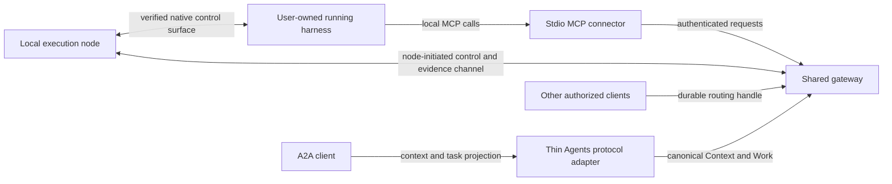

# Shared gateway and joined harnesses: scenario map

The authoritative decisions and source/standards contract are in
[Shared gateway execution contract](shared-gateway-execution-contract.md).
The questions below are qualification prompts, not unresolved permission to
invent fallback behavior. No runtime join is enabled by this document.

Planning only: SH35 and SH36. The baseline release is v0.6.0; it does not
implement remote execution nodes or joining arbitrary running harnesses.

The initial target set is Claude Code, Codex, Pi and OpenCode. Other harnesses,
automatic ownership transfer and terminal keystroke injection are outside scope.

The initial node is an independently supervised local service; MCP-scoped hosts
are deferred. Its command loop remains runnable while an MCP call waits. The
canonical gateway session ID grants neither authorization nor process ownership.

## Existing contracts and evidence

Use the canonical external ownership mode and existing session bindings,
surface capability resolution and controls. Do not create a second session
authority or conflate native conversation IDs with gateway session IDs.

Older shared-thread and steering proposals were retired or superseded; their
presence under `completed/` is not implementation evidence. Fresh user demand
justifies revisiting the capability through new plans and exact-version probes.

Current ACP descriptors do not establish attachment to the existing human UI.
Launching an ACP child, loading a transcript, resuming a conversation and joining
the currently running harness are different capabilities. Native RPC, app-server,
SDK, ACP or a provider-owned bridge must each be assessed on its own evidence.

| Harness | Required first proof | Do not infer |
|---|---|---|
| Claude Code | Verify current-session identity, bidirectional delivery and non-destructive detach | Hooks or an ACP adapter imply control of the existing human session |
| Codex | Verify the exact live surface/thread and simultaneous human/controller behavior | A new ACP session is the current TUI thread |
| Pi | Verify current process/session control, message ordering and steering semantics | A read-only RPC tap grants write/control authority |
| OpenCode | Verify native attach/session API and human/controller coexistence | Native ACP launch proves attachment to an already-running UI |

Advertised, implemented and validated capabilities must remain distinct. A
candidate may be shown as unsupported in inventory, but admission must reject
it before creating a canonical joined session/binding. Only a previously qualified
binding may become temporarily unroutable after evidence loss. Observation or a
heartbeat never proves successful delivery.

## Scenario matrix

| Scenario | Required behavior | Design/proof question |
|---|---|---|
| Current harness joins itself | Verify node, workspace, native ref and current incarnation | What trusted host/provider context proves self-identity? |
| Duplicate local MCP children join | Idempotent registration; one control authority | Which stable native identity deduplicates the registrations? |
| Another client targets the ID | Authenticate and authorize before resolving the binding | How are grants, project scope and revocation represented? |
| Gateway launches a child | Existing owned-process lifecycle remains separate | Which provider surface and worker own the child? |
| Joined user harness is closed in dashboard | Detach/revoke routing, leave harness alive | How do close, purge and reaper paths honor external ownership? |
| Gateway shuts down or upgrades | Externally owned processes continue | Who owns sidecars, and can closing one disturb the harness? |
| MCP call blocks awaiting a result | Independent node control/progress continues | Can the chosen implementation avoid a shared blocking reader? |
| Harness routes work back to itself | Reject/defer unless safe reentrancy is proven | Is the current native turn waiting on this very MCP call? |
| Human is generating; remote prompt arrives | Apply configured queue/verified-steer policy | Which native events reliably prove ready versus busy? |
| Two remote clients submit | Stable ordering, idempotency and caller isolation | Where does the one canonical queue arbitrate? |
| Steer shares an active native turn | Preserve originating request/turn attribution | Does combined output settle one request or several? |
| Human injects another prompt | Record external authorship separately | How are results kept out of the wrong gateway request? |
| Queued request is cancelled | Remove only that request | Can its prompt already be in the native provider queue? |
| Active shared turn is cancelled | Explicit scope/capability decision | Would interruption also cancel human or other-client work? |
| Network dies after prompt acceptance | Reconcile the original operation; do not duplicate | Which local receipt/native turn ID proves disposition? |
| Node or MCP disappears | Distinguish connector loss from harness death | Does a supervised node outlive the connector? |
| Node reboots; provider survives elsewhere | Fence old incarnation; verify any reconnection | Is there an exact surviving native ref, not a guessed latest session? |
| Harness exits; PID is reused | Old binding cannot control the replacement process | What local process-creation evidence is retained? |
| Detach then rejoin | Reuse only proven identity under explicit generation rules | Is a stable logical handle distinct from an immutable binding? |
| Provider requests tool approval | Preserve native/user permission policy | Where are prompts delivered without bypassing approval? |
| Two sessions edit one worktree | Apply explicit local concurrency policy | Which resource/ownership rule prevents conflicting mutations? |
| Local artifact is returned | Explicit transfer or local availability contract | How can another machine retrieve it without a fake server path? |
| Model, profile or workspace changes | Validate/rebind under explicit identity rules | Can in-flight work continue against its frozen context? |
| A2A or external ACP targets a joined session | Authorized canonical Context freezes qualified gateway target | Does Work retain exact session/generation instead of launching a substitute? |
| Two identical-text protocol messages | Distinct message identities create distinct Work | Does replay deduplicate delivery identity rather than prompt content? |
| External protocol sees asynchronous Work | End only on correlated terminal evidence | Can status/response/cancel remain truthful across restart and late output? |

## Research and qualification checklist

### Primary upstream documentation leads

These are research leads, not installed-version attachment qualification:

- [Claude Code Remote Control](https://code.claude.com/docs/en/remote-control)
  documents enabling remote access from an existing local session through Claude's
  interfaces. A general third-party gateway control API still needs verification.
- [Codex App Server](https://developers.openai.com/codex/app-server) documents a
  remote TUI, turn start and in-flight steer. Its WebSocket transport is labeled
  experimental/unsupported; exact live TUI/backend identity and supported versions
  require proof.
- [Pi RPC](https://github.com/earendil-works/pi/blob/main/packages/coding-agent/docs/rpc.md)
  describes a long-lived JSONL subprocess and a separate in-process SDK. Neither
  statement proves retroactive control of an existing interactive instance.
- [OpenCode server](https://dev.opencode.ai/docs/server/) documents a server behind
  the TUI and session-specific APIs. Starting a new `opencode serve` is not joining
  the running TUI's server; registration must bind the actual endpoint/session.

### Contract verification

This scenario matrix qualifies stage 3 joins (and stage 2 node behavior where
applicable), not stage 1 server-only execution. Apply the execution contract's
capability, ownership and concurrency rules and the admission/recovery addendum's
durability rules. This scenario index adds no independent contract or release gate.

Qualification research may proceed independently. Implementation review and
native probes gate only the applicable advertised slice; design endorsement never
enables runtime capability. External A2A/ACP interoperability is eventual SH43
work, not a prerequisite for native attachment qualification.

## Live qualification evidence (`qualify --live`)

`audiagentic qualify --live PROVIDER` runs a provider's native probes against a disposable, credential-free
environment and records one immutable evidence record (SH53). It proves protocol behaviour of the exact
executable, adapter and schema, never a vendor model, authentication, or a human-facing UI, and a record is never
sufficient for a join on its own: the real running instance must still be inspected and matched.

Codex (`codex-app-server`, measured on codex-cli 0.166.0 linux-amd64 over `codex app-server --listen unix://`,
with a local deterministic stub model, loopback on an OS-assigned port, configured only in the disposable
`CODEX_HOME`, no credentials):

| Capability | Result | Why |
|---|---|---|
| passive-identity | proven | an independent client sees the same native thread and creates nothing |
| existing-session-attach | proven | a second client `thread/resume`s the thread while the original client stays operational |
| safe-detach | proven | measured both ways: the observer leaves, and the original client leaves while an observer is attached |
| reconnect | proven (evidence only; the join gate does not read it) | a new client resolves the same thread after every earlier client left |
| conditional-admission | **unsupported** (`unsupported-turn-start-steers-active-turn`) | `turn/start` on a busy thread returns the active turn's own id and adds a model request to that turn: it steers, it does not admit or refuse |
| correlated-result | **unsupported** (`unsupported-concurrent-callers-share-a-turn`) | idle turns are attributable by native turn id, but a second caller during an active turn shares the active turn's id |
| concurrent-human-use | proven, on the **real Codex TUI** | the TUI runs in a pseudo-terminal with `--remote unix://` against the same server; the human's UI keeps working while an observer attaches and after it detaches, an observer's idle turn completes while the TUI is attached, and the human then completes an independent action |

The human-surface experiment (probes/codex_tui.py) also measured the decisive case on a real human turn: while the
human's turn is active an observer's `turn/start` returns **the human's own turn id** and adds model requests to it
(reproduced across runs). It steers the human's turn, so external-session delivery to Codex stays unsupported
(`native-start-steers-active-turn`) even though the human UI otherwise coexists safely with an observer.

Other measured facts: a thread with no turn has no persisted history, so the attach probe seeds synthetic history
through `thread/inject_items` and records that; `codex queue --thread T --message M --remote unix://...` returns a
native message id and does not disturb a streaming turn, but the message is delivered into the same active turn at
its next model request (one turn, a second request), so it is not an idle-conditional admission either. A joined
Codex session therefore cannot be given a prompt through the app-server protocol without risking injection into a
human's active turn; safe delivery can only be gateway-side queueing until the thread is idle, which is not atomic
(a human may start a turn between the idle check and `turn/start`). `reconnect` is evidence only.

The probes use these rules: busy admission is never tested through `turn/steer`; the idle case must admit exactly
once; native turn ids (never text or order) attribute results; the stub receives nothing but `POST /v1/responses`
(any other request fails the probe closed); the stub's reply text is a protocol artefact, never a model claim.
