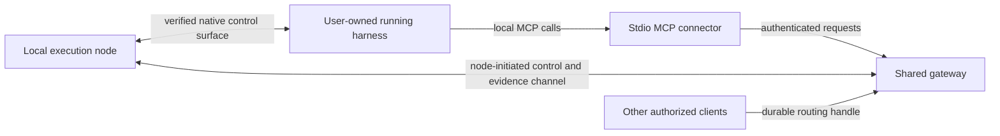

# Shared gateway and joined harnesses: scenario map

Planning only: SH35 and SH36. The baseline release is v0.6.0; it does not
implement remote execution nodes or joining arbitrary running harnesses.

The initial target set is Claude Code, Codex, Pi and OpenCode. Other harnesses,
automatic ownership transfer and terminal keystroke injection are outside scope.

The node may be a shared local service or an explicitly scoped host. Its command
loop must remain runnable while an MCP call waits. A session ID grants routing,
not authorization or ownership of the underlying process.

## Existing contracts and evidence

Use the canonical external ownership mode and existing session bindings,
surface capability resolution and controls. Do not create a second session
authority or conflate native conversation IDs with gateway session IDs.

Older shared-thread and steering proposals were retired or superseded; their
presence under `completed/` is not implementation evidence. Fresh user demand
justifies revisiting the capability through new plans and exact-version probes.

Current ACP descriptors do not establish attachment to the existing human UI.
Launching an ACP child, loading a transcript, resuming a conversation and joining
the currently running harness are different capabilities. Native RPC, app-server,
SDK, ACP or a provider-owned bridge must each be assessed on its own evidence.

| Harness | Required first proof | Do not infer |
|---|---|---|
| Claude Code | Verify current-session identity, bidirectional delivery and non-destructive detach | Hooks or an ACP adapter imply control of the existing human session |
| Codex | Verify the exact live surface/thread and simultaneous human/controller behavior | A new ACP session is the current TUI thread |
| Pi | Verify current process/session control, message ordering and steering semantics | A read-only RPC tap grants write/control authority |
| OpenCode | Verify native attach/session API and human/controller coexistence | Native ACP launch proves attachment to an already-running UI |

Advertised, implemented and validated capabilities must remain distinct. A
registration can be non-routable when control is unproven; it cannot report a
successful prompt delivery based only on observation or a heartbeat.

## Scenario matrix

| Scenario | Required behavior | Design/proof question |
|---|---|---|
| Current harness joins itself | Verify node, workspace, native ref and current incarnation | What trusted host/provider context proves self-identity? |
| Duplicate local MCP children join | Idempotent registration; one control authority | Which stable native identity deduplicates the registrations? |
| Another client targets the ID | Authenticate and authorize before resolving the binding | How are grants, project scope and revocation represented? |
| Gateway launches a child | Existing owned-process lifecycle remains separate | Which provider surface and worker own the child? |
| Joined user harness is closed in dashboard | Detach/revoke routing, leave harness alive | How do close, purge and reaper paths honor external ownership? |
| Gateway shuts down or upgrades | Externally owned processes continue | Who owns sidecars, and can closing one disturb the harness? |
| MCP call blocks awaiting a result | Independent node control/progress continues | Can the chosen implementation avoid a shared blocking reader? |
| Harness routes work back to itself | Reject/defer unless safe reentrancy is proven | Is the current native turn waiting on this very MCP call? |
| Human is generating; remote prompt arrives | Apply configured queue/verified-steer policy | Which native events reliably prove ready versus busy? |
| Two remote clients submit | Stable ordering, idempotency and caller isolation | Where does the one canonical queue arbitrate? |
| Steer shares an active native turn | Preserve originating request/turn attribution | Does combined output settle one request or several? |
| Human injects another prompt | Record external authorship separately | How are results kept out of the wrong gateway request? |
| Queued request is cancelled | Remove only that request | Can its prompt already be in the native provider queue? |
| Active shared turn is cancelled | Explicit scope/capability decision | Would interruption also cancel human or other-client work? |
| Network dies after prompt acceptance | Reconcile the original operation; do not duplicate | Which local receipt/native turn ID proves disposition? |
| Node or MCP disappears | Distinguish connector loss from harness death | Does a supervised node outlive the connector? |
| Node reboots; provider survives elsewhere | Fence old incarnation; verify any reconnection | Is there an exact surviving native ref, not a guessed latest session? |
| Harness exits; PID is reused | Old binding cannot control the replacement process | What local process-creation evidence is retained? |
| Detach then rejoin | Reuse only proven identity under explicit generation rules | Is a stable logical handle distinct from an immutable binding? |
| Provider requests tool approval | Preserve native/user permission policy | Where are prompts delivered without bypassing approval? |
| Two sessions edit one worktree | Apply explicit local concurrency policy | Which resource/ownership rule prevents conflicting mutations? |
| Local artifact is returned | Explicit transfer or local availability contract | How can another machine retrieve it without a fake server path? |
| Model, profile or workspace changes | Validate/rebind under explicit identity rules | Can in-flight work continue against its frozen context? |

## Decisions reserved for round-table review

1. Local node lifetime and how a current stdio MCP discovers or starts it.
2. Trusted self-registration proof for each of the four harnesses.
3. Durable routing handle versus Context/Work/session/native ref and generations.
4. How node-local execution manifests are admitted without server path fabrication.
5. Exact native attachment and prompt-push capabilities, including unsupported cases.
6. Queue/steer configuration, visible fallback/rejection and later client overrides.
7. Human/remote concurrency, cancellation scope and response attribution.
8. Recovery receipts, stale-epoch fencing, permissions and revocation.
9. Minimal approved API/MCP/CLI additions and complete metadata/documentation updates.

Review sequence: source/capability inventory and scenarios, then candidate
contracts and adversarial state walkthroughs, then version-pinned capability
probes and a code-level implementation plan. No runtime capability is enabled by
this document or by a design endorsement alone.
